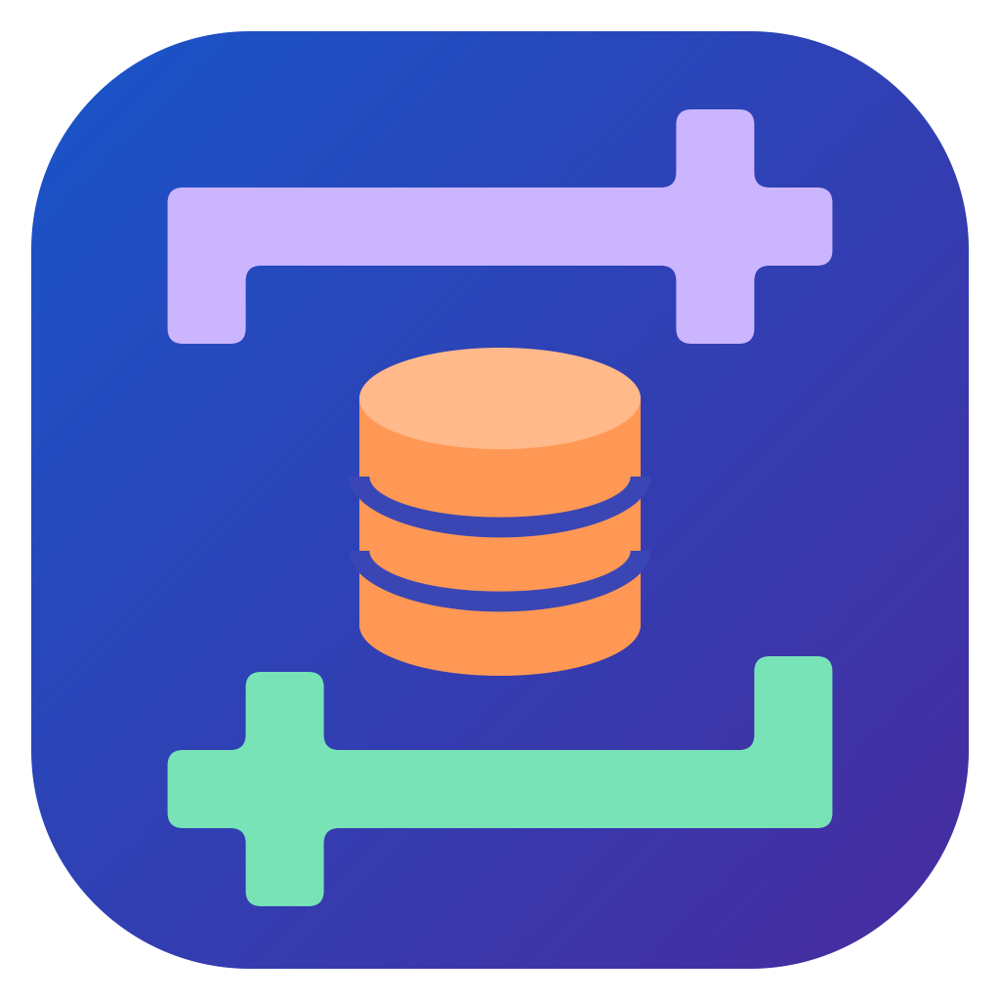

# Access Exporter



[English](README.md) | **Nederlands** | [Français](README.fr.md)

## Wat doet het?

Access Exporter is een klein Windows-programma om gegevens **uit** een Microsoft Access-database (`.accdb` / `.mdb`)
te halen en, als je wilt, er ook weer **in** te zetten. Je hebt Microsoft Access zelf niet nodig, en ook geen
technische kennis.

- **Exporteren** – zet de tabellen van één of meer Access-databases om naar een Excel-werkmap of naar CSV-bestanden,
  bijvoorbeeld om de gegevens te controleren, op te schonen of met een klant te delen.
- **Bewerken** – open een Access-database of een geëxporteerd Excel-/CSV-bestand en wijzig waarden direct in het
  programma, net als in een spreadsheet.
- **Terugzetten naar Access** – zet een bewerkte Excel-/CSV-export terug in de database.

**Je originele database wordt nooit gewijzigd.** Elke bewerking of samenvoeging wordt opgeslagen als een *nieuwe
kopie* van de database, met datum en tijd in de naam (bijvoorbeeld `Klanten_merged_20260520-143000.accdb`). Klopt er
iets niet, verwijder dan gewoon de kopie en begin opnieuw.

Typisch gebruik: exporteer een klantdatabase naar Excel, laat de klant de gegevens corrigeren, zet het gecorrigeerde
bestand terug in een kopie van de database en lever die kopie op.

## Inhoud

- [Installatie](#installatie)
- [Tabellen exporteren](#tabellen-exporteren)
- [Gegevens bewerken](#gegevens-bewerken)
- [Terugzetten naar Access](#terugzetten-naar-access)
- [Uiterlijk en taal](#uiterlijk-en-taal)
- [Goed om te weten](#goed-om-te-weten)
- [Problemen oplossen](#problemen-oplossen)
- [Voor ontwikkelaars](#voor-ontwikkelaars)
- [Licentie](#licentie)

## Installatie

1. Download `AccessExporter.exe` uit de
   [nieuwste release](https://github.com/DevoteamNL/access_exporter/releases/latest). Installeren is niet nodig; je
   kunt het vanuit elke map starten. Windows kan de eerste keer een SmartScreen-waarschuwing tonen: kies
   **Meer informatie → Toch uitvoeren**.
2. Het programma heeft de gratis **Microsoft Access Database Engine** (64-bit) nodig, het onderdeel van Access dat
   databasebestanden leest. Veel Office-installaties hebben dit al. Ontbreekt het, dan meldt het programma dat bij het
   opstarten; installeer het dan via
   [Microsoft](https://www.microsoft.com/nl-nl/download/details.aspx?id=54920) (`accessdatabaseengine_X64.exe`).

Om de download te controleren vergelijk je de SHA256-controlesom met het bestand `AccessExporter.exe.sha256` in de
release: `Get-FileHash .\AccessExporter.exe` in PowerShell.

## Tabellen exporteren

Gebruik het tabblad **📤 Exporteren**.

1. **📂 1. Kies Access-bestand** – of sleep een `.accdb`/`.mdb`-bestand op het venster. De tabellen worden geladen
   en allemaal geselecteerd. Vink **Ook opgeslagen query's** aan om ook de opgeslagen query's van de database te
   exporteren.
2. **⚙ 2. Kies Exportformaat** – **📊 1 Excel-bestand (.xlsx)** met één werkblad per tabel, of
   **📄 Aparte CSV's per tabel (.csv)**. Bij CSV kies je **Decimale komma (1,5)** (Nederlandse/Europese Excel) of
   **Decimale punt (1.5)**.
3. **📋 3. Kies te exporteren tabellen** (optioneel) – filter, vink aan en bekijk de eerste rijen van elke tabel.
4. **📁 4. Kies Doelmap** – standaard de map van het Access-bestand.
5. **➕ 5. Voeg toe aan wachtrij**, daarna **▶️ Converteer Selectie** of **🚀 Converteer Hele Wachtrij**.

Je kunt meerdere databases in de wachtrij zetten, elk met eigen instellingen. Voortgang en meldingen verschijnen in
**Logboek - Live status**. **🧹 Wis afgeronde taken** ruimt de wachtrij op; <kbd>Delete</kbd> verwijdert de
geselecteerde rijen. Vink **Map openen na afloop** aan om de doelmap automatisch te openen.

Naast elke export schrijft het programma een klein `.export.json`-bestand. Daarin staat uit welke database en welke
tabel elk werkblad of CSV-bestand komt, zodat bij het terugzetten de juiste tabellen al voor je zijn ingevuld. Laat
het naast de export staan als je wilt terugzetten.

Details: tabellen groter dan de Excel-limiet (1.048.576 rijen) worden over meerdere werkbladen verdeeld (`Tabel_1`,
`Tabel_2`, …); CSV-bestanden gebruiken `;` en UTF-8, zodat ze goed openen in Excel; tekst zoals `=SUM(A1)` blijft
gewone tekst.

## Gegevens bewerken

Gebruik het tabblad **✏️ Bewerken**.

1. Klik op **🗄 Open Access-database...** of **📂 Open CSV/Excel-bestand...** (of sleep een bestand op het tabblad).
2. Kies een tabel of werkblad bij **Tabel / blad:** en wijzig cellen door erop te dubbelklikken. Gebruik
   **🔍 Zoeken in alle kolommen... (Ctrl+F)** om rijen te vinden, en **➕ Rij toevoegen** en **➖ Rijen verwijderen**
   (of <kbd>Delete</kbd>). Waarden die niet bij de kolom passen (bijvoorbeeld tekst in een getalkolom) worden met een
   melding geweigerd.
3. Klik op **💾 Opslaan als...** en kies een naam. Een naam met datum en tijd is al ingevuld.
   - Bij een Access-database worden alle wijzigingen in een **nieuwe kopie** van de database geschreven, die daarna in
     de editor wordt geopend.
   - Bij een Excel-bestand worden alle werkbladen opgeslagen; bij een CSV-bestand het huidige blad.

Sluit je het programma of open je een ander bestand terwijl er niet-opgeslagen wijzigingen zijn, dan wordt gevraagd
of je ze wilt weggooien.

## Terugzetten naar Access

Gebruik het tabblad **🔁 Terugzetten naar Access**.

1. **1. Originele Access-database** – **🗄 Kies database...** (de database waar de export vandaan komt).
2. **2. Bewerkte bestanden en doeltabellen** – **📂 Bestanden toevoegen...** met je bewerkte Excel-/CSV-bestanden.
   Controleer per werkblad of bestand de **Doeltabel in Access** (waar mogelijk automatisch ingevuld) of kies
   *(overslaan)*.
3. **3. Hoe samenvoegen?**
   - **Bijwerken en toevoegen (op primaire sleutel)** – gewijzigde rijen worden bijgewerkt, nieuwe rijen toegevoegd.
     Aanbevolen.
   - **Alleen nieuwe rijen toevoegen** – bestaande rijen blijven ongemoeid.
   - **Tabelinhoud vervangen** – de tabel wordt leeggemaakt en gevuld met het bestand.
   - **Rijen die niet meer in het bestand staan ook verwijderen** – optioneel, alleen bij *Bijwerken en toevoegen*.
4. **4. Controleren en samenvoegen** – **🔍 Voorbeeld berekenen** toont per tabel hoeveel rijen worden toegevoegd,
   gewijzigd, verwijderd of ongewijzigd blijven, en eventuele fouten. Klik daarna op
   **💾 Samenvoegen in nieuwe kopie...**, bevestig de naam van de nieuwe kopie en de samenvatting.

Alle wijzigingen worden in één keer geschreven: mislukt er iets of klik je op **⏹ Stop**, dan blijft er niets
bewaard en wordt de onvoltooide kopie verwijderd.

## Uiterlijk en taal

Bovenaan het venster:

- **Thema** – **Systeem** (volgt de lichte/donkere modus van Windows, de standaard), **Licht** of **Donker**.
- **Taal** – **Nederlands** (standaard), **English** of **Français**. Teksten, meldingen en het logboek wisselen
  direct; je gegevens worden nooit vertaald.

Beide keuzes worden onthouden, samen met je laatste mappen en exportinstellingen (opgeslagen in het Windows-register
onder `HKEY_CURRENT_USER\Software\AccessExporter\AccessExporterPyQt6`).

## Goed om te weten

- **Databases met een wachtwoord** – het programma vraagt om het wachtwoord. Het wordt alleen bewaard zolang het
  programma open is en nooit opgeslagen.
- **Tabellen zonder primaire sleutel** worden in de editor alleen-lezen getoond. Gebruik bij terugzetten voor deze
  tabellen *Alleen nieuwe rijen toevoegen* of *Tabelinhoud vervangen*.
- **Grote tabellen** – de editor laadt maximaal 100.000 rijen per tabel; rijen daarboven blijven bij opslaan
  ongemoeid.
- **Bijlagen, afbeeldingen en andere binaire kolommen** worden niet geëxporteerd en blijven bij terugzetten
  ongewijzigd.
- **AutoNummering-kolommen** worden voor nieuwe rijen door Access ingevuld.
- Sluit de database in Microsoft Access voordat je terugzet of opslaat; het programma waarschuwt als hij open lijkt
  te zijn.

## Problemen oplossen

| Melding of probleem | Wat te doen |
|---------------------|-------------|
| *Access-driver ontbreekt* bij het opstarten | Installeer de 64-bit Microsoft Access Database Engine (zie [Installatie](#installatie)). Start je vanaf de broncode, dan moet de bitness (32/64-bit) gelijk zijn aan die van Python. |
| *Database in gebruik* | Sluit de database in Access (een `.laccdb`/`.ldb`-bestand ernaast betekent dat hij open is) en probeer het opnieuw. |
| Verkeerde getallen in Excel na een CSV-export | Kies in stap 2 de andere decimaalinstelling. |
| Een rij toont fouten in het voorbeeld bij terugzetten | De waarde past niet bij het kolomtype (bijvoorbeeld tekst in een datumkolom). Corrigeer het in het bestand of in het tabblad **✏️ Bewerken** en bereken het voorbeeld opnieuw. |

## Voor ontwikkelaars

Vereisten: Windows, Python 3.10+, de Access Database Engine met dezelfde bitness als Python.

```powershell
git clone https://github.com/DevoteamNL/access_exporter.git
cd access_exporter
python -m venv .venv
.venv\Scripts\python.exe -m pip install -r requirements.txt pytest
.venv\Scripts\python.exe access_exporter_pyqt6.py        # programma starten
.venv\Scripts\python.exe -m pytest -q tests              # tests uitvoeren
.\build.ps1                                              # dist\AccessExporter.exe bouwen
```

- De code staat in het pakket `access_exporter`: `core.py` (databasetoegang, geen Qt), `file_io.py` (Excel/CSV),
  `merge.py` (vergelijken en terugschrijven), `main_window.py`, `editor_tab.py`, `merge_tab.py`, `themes.py`,
  `translations.py`. `access_exporter_pyqt6.py` is het startpunt.
- Tests die de Access-driver nodig hebben maken een tijdelijke database aan en worden overgeslagen als de driver
  ontbreekt; de andere tests gebruiken het offscreen-platform van Qt.
- Teksten in de interface zijn in het Nederlands geschreven; Engels en Frans staan in `TRANSLATIONS` in
  `translations.py`.
- Het icoon is getekend in `access_exporter/assets/access-exporter.svg`; voer `python tools/generate_app_icon.py`
  uit om de `.ico` en `.png` opnieuw te maken.
- Bij het publiceren van een GitHub-release wordt de exe gebouwd en met controlesom geüpload
  (`.github/workflows/release-assets.yml`). Wijzigingen staan in [CHANGELOG.md](CHANGELOG.md).

## Licentie

[GNU General Public License v3.0](LICENSE) (GPL-3.0-only), in lijn met de licentie van PyQt6, dat in het programma is
opgenomen.
